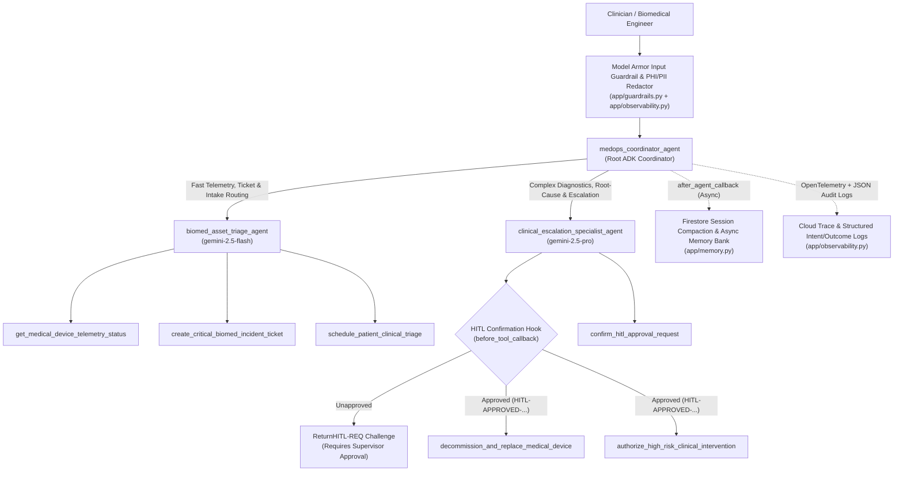

# MedOps Sentinel — Smart Healthcare Clinical Triage & Biomedical Asset Operations Agent

**MedOps Sentinel** is an enterprise-grade multi-agent system built on the **Google Cloud Gemini Enterprise Agent Platform** using the **Google Agent Development Kit (ADK)**. It combines **Agents for Good (Healthcare Clinical Triage)** with **Enterprise IT/Biomedical Asset Operations**, following the architecture and best practices from Romin Irani's 5-part *Gemini Enterprise Agent Platform* tutorial series.

---

## Architecture Overview



---

## AgentOps Code Review Matrix (95 / 95 Points Mapping)

| Category | Criteria (5 pts each) | Implementation Location |
| :--- | :--- | :--- |
| **1. Tool & Interface Design (20 pts)** | **Comprehensive Tool Docstrings** | `app/tools.py` — Full Google-style docstrings (`Args`, `Returns`, recovery guidance) on all 6 tools. |
| | **Descriptive Naming** | `app/tools.py` — `get_medical_device_telemetry_status`, `create_critical_biomed_incident_ticket`, `schedule_patient_clinical_triage`, `decommission_and_replace_medical_device`, `authorize_high_risk_clinical_intervention`, `confirm_hitl_approval_request`. |
| | **Explicit JSON Schemas** | `app/schemas.py` — Strict Pydantic v2 `BaseModel` classes + Draft-07 `TOOL_INPUT_JSON_SCHEMAS` and `TOOL_OUTPUT_JSON_SCHEMAS` with `validate_tool_arguments_with_schema()`. |
| | **Guided Error Handling** | `app/tools.py` & `app/schemas.py` — Structured error payloads returning `error_code` and actionable `recovery_instructions` for LLM self-correction. |
| **2. Context & Memory (20 pts)** | **Robust System Instructions** | `app/prompts.py` — Explicit `<constitution>` defining `<persona>`, `<domain_knowledge>`, `<hitl_governance>`, and `<privacy_and_security_constraints>`. |
| | **History Compaction** | `app/memory.py` — `compact_conversation_history()` (token-budget & sliding-window truncation + rolling summary) and `build_adk_compaction_and_cache_config()`. |
| | **Persistent Session State** | `app/memory.py` — `FirestoreSessionAndMemoryStore` backed by Google Cloud Firestore (`google-cloud-firestore`) with local fallback for CI/offline evaluation. |
| | **Async Memory Operations** | `app/memory.py` — `consolidate_session_memories_async()` & `trigger_async_memory_consolidation()` registered as ADK `after_agent_callback` running in a background worker pool. |
| **3. Orchestration & Logic (20 pts)** | **Multi-Agent Patterns** | `app/agent.py` — Root Coordinator (`medops_coordinator_agent`), specialized `LlmAgent` sub-agents (`biomed_asset_triage_agent`, `clinical_escalation_specialist_agent`), and `SequentialAgent` (`clinical_diagnostic_pipeline_agent`). |
| | **Strategic Model Routing** | `app/agent.py` — `select_optimal_model_for_request()` routes fast lookups/intake to `gemini-2.5-flash` and complex clinical/engineering escalations to `gemini-2.5-pro`. |
| | **Guardrails & Policy Plugins** | `app/guardrails.py` — `model_armor_input_guardrail_plugin` (`before_model_callback`) blocking prompt injection & persona overrides + `self_evaluation_output_guardrail_plugin` (`after_model_callback`). |
| | **Human-in-the-Loop Hooks** | `app/guardrails.py` — `require_hitl_confirmation_before_tool_hook` (`before_tool_callback`) halting high-stakes decommissioning and ICU/clinical orders until approved via `confirm_hitl_approval_request`. |
| **4. Observability & Tracing (20 pts)** | **Structured JSON Logging** | `app/observability.py` — `StructuredJsonFormatter` & `get_structured_logger()` emitting single-line JSON logs with trace/span correlation and zero `print()` calls. |
| | **Intent vs. Outcome Capture** | `app/observability.py` — `log_tool_intent()` (`AGENT_TOOL_INTENT` before execution) and `log_tool_outcome()` (`AGENT_TOOL_OUTCOME` after execution with latency). |
| | **Distributed Tracing** | `app/observability.py` — OpenTelemetry `TracerProvider`, `CloudTraceSpanExporter`, and `start_distributed_span()` linking parent/child spans across turns and tools. |
| | **PII Redaction** | `app/observability.py` — `PIIRedactionFilter`, `redact_sensitive_phi_pii()`, and `redact_with_cloud_dlp()` scrubbing SSNs, MRNs, emails, phone numbers, DOBs, and payment cards before logging or storage. |
| **5. Infrastructure & CI/CD (15 pts)** | **Automated Evaluation Suites** | `eval/medops_eval_set.json`, `eval/eval_config.json`, `eval/run_evaluation_harness.py`, and `tests/test_medops_agent.py`. |
| | **Infrastructure as Code** | `terraform/main.tf`, `terraform/variables.tf`, `terraform/outputs.tf`, `agents-cli-manifest.yaml`, `Dockerfile`, and `.github/workflows/ci_eval.yml`. |
| | **Secure Secret Management** | `app/secrets.py` — `SecretManagerVault` using `google-cloud-secret-manager` with ADC authentication and TTL caching (zero hardcoded credentials). |

---

## Quickstart & Local Verification

### 1. Install Dependencies
```bash
uv pip install -e ".[dev]"
```

### 2. Run Deterministic Unit Tests & Rubric Verification
```bash
python3 -m unittest discover -s tests -v
```

### 3. Run the Golden Dataset Evaluation Suite
Using the standalone evaluation harness:
```bash
python3 -m eval.run_evaluation_harness
```
Or using the ADK Eval CLI (Part 5 of the Gemini Enterprise Agent Platform tutorial series):
```bash
uv run adk eval app eval/medops_eval_set.json \
  --config_file_path=eval/eval_config.json \
  --print_detailed_results
```

### 4. Launch Local Interactive Playground (Part 1)
```bash
agents-cli playground
# or
uv run adk web app
```

### 5. Provision Infrastructure & Deploy to GCP (Parts 3 & 4)
```bash
cd terraform
terraform init
terraform apply -var="project_id=${GOOGLE_CLOUD_PROJECT}"
cd ..
./scripts/deploy_agent.sh
```
